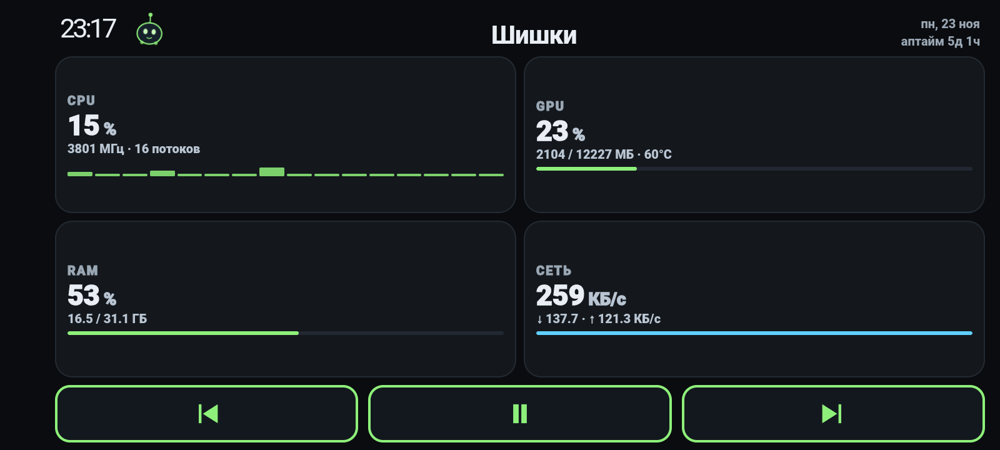

# PC Dashboard for an Old Phone (USB)

Turn a spare Android phone into a always-on desk dashboard for your Windows PC:
CPU / GPU / RAM / network load, the current track title, three big media buttons
and a small mascot that shows whether your AI agent is working or waiting for you.

The phone talks to the PC **over USB only** (`adb reverse`), so there is no Wi-Fi,
no extra APK, no cloud account — just a web page served by a local Python process.



## Features

- **One process, tiny footprint** — ~45 MB RAM, well under 1% of one core.
- **CPU** per-core bars + frequency + thread count, **GPU** (NVIDIA via `nvidia-smi`),
  **RAM**, **network** throughput.
- **Now playing** — the track title is rendered big and bold in the header and hides
  itself when playback is paused. Long titles scroll back and forth.
- **Media control** — three full-width buttons (previous / play-pause / next) driven by
  the Windows Global System Media Transport Controls session (works with Spotify,
  Yandex Music, AIMP, browsers, ...).
- **Self-healing USB bridge** — re-applies `adb reverse`, keeps the screen awake,
  locks the screen to landscape, and reopens the page if the browser gets closed,
  crashes or drifts to another tab.
- **Optional mascot** — if a Hermes (`state.db`) database is present, the little robot
  sleeps when the agent is idle, works while it is busy and calls you when an answer lands.

## Requirements

| What | Notes |
|------|-------|
| Windows 10/11 | tested on Windows 11 25H2 |
| Python 3.10+ | 3.12 recommended |
| Android phone | USB debugging enabled, any browser is fine |
| `adb` | platform-tools; either on `PATH`, next to `dashboard.py`, or in `platform-tools/` |
| NVIDIA GPU | optional — the GPU card just stays empty without `nvidia-smi` |

## Install

```bat
git clone https://github.com/<you>/pc-dashboard.git
cd pc-dashboard
python -m venv .venv
.venv\Scripts\pip install -r requirements.txt
copy config.example.json config.json
```

On the phone: enable *Developer options → USB debugging*, plug the cable in and accept
the RSA prompt. Then check that Windows sees it:

```bat
adb devices
```

Start the dashboard:

```bat
start.bat
```

The page ends up at `http://127.0.0.1:8765/` **on the phone** (the port is forwarded over
USB). The watchdog opens it automatically, taps once for fullscreen, and keeps it there.

To launch it with Windows, press `Win+R`, run `shell:startup` and drop a shortcut to
`start.bat` into that folder.

## Configuration

`config.json` (all keys optional):

| Key | Default | Meaning |
|-----|---------|---------|
| `port` | `8765` | HTTP port, also used for `adb reverse` |
| `adb` | auto | path to `adb.exe` |
| `serial` | first device | device serial from `adb devices` |
| `usb_bridge` | `true` | set `false` to disable the watchdog entirely |
| `browser` | `com.yandex.browser/.YandexBrowserActivity` | activity started with the page |
| `browser_pkg` | `com.yandex.browser` | package name used by the watchdog to check the foreground app |
| `rotation` | `1` | `0` / `1` (90°) / `3` (270°) |
| `fullscreen_tap` | `[800, 400]` | tap coordinate (device pixels) that enters fullscreen |
| `screen_timeout_ms` | `1800000` | screen-off timeout while charging |
| `disk_path` | `C:\\` | volume for the disk stat |
| `hermes_db` | auto-detect | Hermes `state.db`, enables the mascot |

Chrome on some old devices dies with *"this app isn't compatible with the latest version
of Android"*; Yandex Browser is the default for that reason. Any Chromium browser with a
fullscreen API works — just set `browser` / `browser_pkg` / `fullscreen_tap` for it.

## HTTP API

| Endpoint | Description |
|----------|-------------|
| `GET /api/stats` | JSON snapshot: `cores`, `cpu`, `freq`, `gpu`, `ram`, `net`, `np`, `agent` |
| `POST /api/media` | `{"action": "prev" \| "toggle" \| "next"}` |

The page polls `/api/stats` once a second — that is also how the watchdog knows the phone
is still showing it.

## Layout notes

- `index.html` is self-contained: inline CSS/JS, one grid, no build step, no CDN.
- Cards are deliberately heavy (bold labels plus `-webkit-text-stroke`) because the phone
  is read from a metre away.
- Landscape is the intended orientation; portrait still works and reflows to two columns.

## License

MIT.
